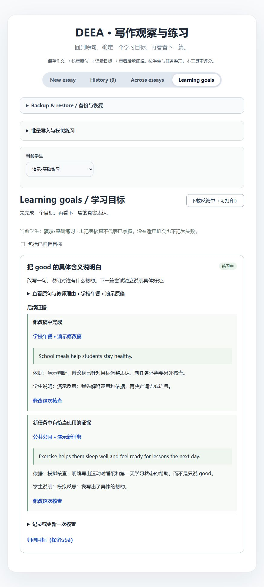

# DEEA｜写作观察与练习

DEEA 把原句证据、教师判断和后续写作连接起来：按学生整理作文，选择一个具体目标，再核查修改稿和新的独立任务。词频用于寻找线索，不能代替语境判断或证明学习进步。

**当前分支：v0.5，[草稿 PR #10](https://github.com/gwx4399-cell/coca-word-frequency-tool/pull/10) 已实现，尚未合并或发布。**

DEEA 的英文名称是 Academic English Evolution Agent；当前在浏览器本地运行，使用 COCA 衍生词表与明确规则，没有接入 AI 模型，不自动评分或诊断语义。



## 先用模拟材料体验

无需教师账号或真实学生材料：

1. 展开 **批量导入与模拟练习**，点击 **预览三组模拟练习**。核对新增记录后确认；现有作文保留。
2. 进入 **Learning goals**，选择“演示·基础练习”“演示·表达拓展”或“演示·语义与语气”。每组有一个目标和原稿、修改稿、新任务三个短切片。
3. 查看原句与教师理由，从“记录或更新一次核查”中选择新任务、具体原句和人工判断，填写依据并保存。未核查不等于掌握，没有适用机会也不记为失败。
4. 进入 **History** 查看原稿与修改稿对照；可创建新的修改稿或保存教学判断。使用 **下载反馈单（可打印）** 获取包含理由、练习与后续证据的 HTML 文件，浏览器可打印或保存 PDF。
5. 在 **Across essays** 选定学生和文体，选择每任务原稿或最新稿，并核对比较范围。同一任务的多个版本只取一份。

这些是虚构、未评分的短文切片，不是完整 IELTS 答卷或真实教学实验。初次载入不会自动判定新任务表现。重复导入相同内容不新增作文；如果改动过演示判断，再次导入可能保留另一个判断版本供核对。

## 当前能力

| 能力 | 行为与边界 |
| --- | --- |
| 单篇分析 | 默认展示出现至少 3 次的分析词，可搜索原文词形和低次数词，定位原句并高亮。规则归并可能出错，需要看原文。 |
| 学生与任务 | 学生编号/昵称、文体、任务名称和稿件类型。旧记录保持未分组。同名学生需不同编号；这些是分组标识，不是登录账号。标题在同一学生下须唯一。 |
| 跨篇观察 | 先选学生、文体和稿件范围，每任务只取一稿。至少两篇、累计三次的词才进入复现列表。显示每篇词数及每百词频率，便于考虑篇幅，不作为质量分。最近三篇提示也使用所选范围。 |
| 修改关系 | 从历史创建修改稿，原文不变，保留版本关系和并排对照。新的独立任务由使用者明确标记，工具不验证是否独立完成。 |
| 教学判断 | 选择原句，记录保留、具体化、搭配/语气、归并错误与理由。可编辑保存的判断；不会自动改动原文或分析算法。 |
| 学习目标 | 通常每位学生同时最多两个目标。人工核查修改稿、新任务、仍需练习或无适用机会，保存依据和学生反思。可归档、恢复。 |
| 批量导入 | 选学生、文体和共享写作日期，预览并导入多个 UTF-8 TXT。每文件是一个任务原稿；修改稿从历史创建。最多 50 文件/3 MB。 |
| 反馈单 | 下载当前学生活跃目标，或某个任务全部版本中的教学判断。HTML 文件有 A4 打印样式，长内容会分页。 |
| 备份与恢复 | v2 JSON 包含全部学生、原文、版本、判断、目标和核查，兼容 v1 导入。确认前预览，冲突内容保留，损坏历史暂停写入。JSON 文件上限 10 MB，浏览器容量可能更小。 |

四词观测组仍仅比较 important、significant、essential、crucial 的出现次数。其占比分母不是所有表达“重要性”的机会；例如 statistically significant 可能有特定含义。计数下降、替换成低频词或目标词没有出现，都不会自动判定进步。

## 在本地运行

推荐与 CI 一致的 Node.js 22。进入本项目目录后运行：

```bash
npm ci
npm run dev
```

验证与生产预览：

```bash
npm test
npx tsc --noEmit
npm run build
npm run preview
```

作文与教学记录只保存在当前浏览器地址的 localStorage；不因分析、导入或保存而上传。清理站点数据或换设备前需要外部备份。不同访问地址的数据独立；没有云同步或自动草稿保存。

## 验证与已知边界

71 项测试覆盖分析、学生隔离、稿件选择、原句锚点、目标及人工核查、旧数据兼容、备份冲突与引用重映射、容量失败、TXT 整批导入及反馈单转义。另运行类型检查、生产构建和浏览器模拟走查；大词表包体提示仍存在。

没有真实教师或学生参与，没有测量时间节省、满意度或学习效果。人工保存的核查状态是教学记录，不是自动测评。暂未验证真实移动硬件、辅助技术、大规模历史或长期课堂使用；没有账号权限管理、LMS 集成、上下文词义诊断或 AI 建议。

| 材料 | 入口 |
| --- | --- |
| v0.5 产品需求 | [中文](./docs/iterations/v0.5/DEEA_PRD_CN.md) / [English](./docs/iterations/v0.5/DEEA_PRD_EN.md) |
| v0.5 技术设计 | [中文](./docs/iterations/v0.5/DEEA_TECHNICAL_DESIGN_CN.md) / [English](./docs/iterations/v0.5/DEEA_TECHNICAL_DESIGN_EN.md) |
| 模拟走查与截图 | [体验记录](./docs/iterations/v0.5/USABILITY_REVIEW_CN.md) |
| 实际下载的示例反馈单 | [HTML](./docs/iterations/v0.5/evidence/sample-feedback.html)，仅含虚构材料 |
| 历史版本与作品集证据 | [完整文档索引](./docs/README.md) / [v0.4 原句核查](./docs/iterations/v0.4/USABILITY_REVIEW_CN.md) |

原有[五篇完整测试作文](./data/demo/IELTS_TASK2_FIVE_ESSAYS.md)继续参与回归。若手动录入，给它们指定相同学生、议论文文体和不同任务名称，再选该学生/文体查看统计。它们也是虚构、未评分样本。

## 数据来源与许可

**Word frequency data from the Corpus of Contemporary American English (COCA).** Source text: wordfrequency.info.

附带数据是 COCA 衍生的 Top-frequency 词表，不是完整语料库。代码的 MIT 许可不等于该数据也按 MIT 授权；参阅 [NOTICE](./NOTICE.md)和[数据说明](./data/README_COCA_top5050.txt)。

## English overview

DEEA is a browser-local teaching workflow connecting source sentences, human decisions, learning goals, revisions and later independent writing. The v0.5 draft branch adds student/task scoping, one-draft-per-task comparison, anchored notes, manual goal checks, batch TXT import and printable feedback. Version 2 backups preserve all relationships and accept legacy v1 data. Three fictional scenarios let the owner exercise the workflow without claiming a teacher study. Counts, suggested prompts and recorded judgments do not establish writing quality or learning gains. The branch is not merged or publicly deployed.
