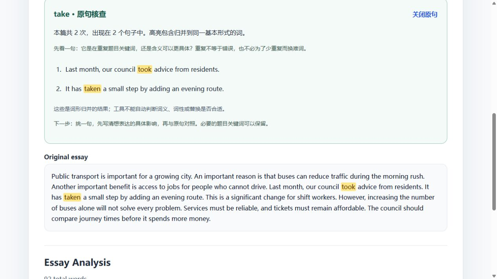

# DEEA v0.4 多角色、三轮模拟体验记录
日期：2026-11-03（Asia/Taipei）。状态：本地改进分支；尚未发布到 GitHub Pages。

## 方法与真实性
由同一个代理按三种学生角色和教师角色顺序执行任务，边操作边观察页面与截图。不是人类访谈，也不是独立的多代理评审。所谓 IELTS 4–5、5.5–6.5、6.5–7.5 是设计任务时的预设，未给样本评分，不能据此推断真实学生表现或教学效果。

[data/demo/USABILITY_SCENARIOS.json](../../../data/demo/USABILITY_SCENARIOS.json)保存九段原创、未评分的英文任务切片，约 70–100 词，用于聚焦操作路径；不冒充完整 IELTS Task 2 作文。原仓库五篇超过 250 词的作文继续参加自动回归。三组使用不同本地端口隔离历史；教师查看中等组与较高组证据。另以空白 localhost 地址测试备份恢复。浏览器录入记录均显示同一天，跨篇顺序亦检验同日创建顺序；未声称完成跨日纵向验证。

每轮先检查可操作的页面状态，再执行下一轮。判断标准：是否能保存、找到对应词、核对计数与原句、返回比较、确认导入而不丢数据。没有编造用户引语、满意度、完成时间或学习增益。

## 三轮记录
| 角色 | 第一轮：首次录入/核查 | 第二轮：再次使用/比较 | 第三轮：累计与恢复 |
| --- | --- | --- | --- |
| 基础组，预设约 4–5 分 | School sports：good 3 次；write 的 wrote/written/write 共 3 次，2 个句子，均可高亮。 | School meals：good 跨篇 2/2，累计 6 次。用户需要理解“重复不必改”；页面提供中文说明。 | Free libraries：add 跨篇 3/3，累计 6 次，含 added/adding；没有误计到 ad。 |
| 中等组，预设约 5.5–6.5 分 | Public transport：important 3 次，逐句核查其具体作用。 | Online learning：important 2/2、累计 5 次，展开每篇并回到原句。 | Public parks：important 3/3、累计 7 次；最近三篇建议提供有限练习方向。备份往返后仍为 7。 |
| 较高组，预设约 6.5–7.5 分 | Urban trees 默认无 ≥3 次词；展开全部得到 57 行，暴露查找负担。 | Evidence and policy：搜索 significant，可直接核查只出现 1 次的 statistically significant。 | Museum access：significant 每篇 1 次，累计 3/3、3 次；没有把低次数显示规则应用于跨篇分子。 |
| 教师 | 在历史中搜索原文词形 took，正确找到 take，核对 took/taken 两句及全文高亮。 | 从 important 的跨篇记录打开原文，再返回，原词条保持展开，继续逐篇比较。比较 statistically significant 与普通重要性含义，发现试验组标签需要更明确。 | 导出中等组 3 篇，重复导入预览“新增 0、跳过 3”；确认并刷新仍 History (3)、important=7。空白地址导入预览“新增 3”，恢复后仍 3/3、7 次。 |

## 观察 → 修改 → 复查
| 发现 | 修改 | 复查证据 |
| --- | --- | --- |
| 点击原句后只把标题滚到屏幕底部，证据仍在视口外。 | 将原句标题定位到视口上方，并设置焦点。 | 教师核查 take 的截图中两句与全文高亮均可见。 |
| 较高组只有 77 词，显示全部却有 57 行，定位目标词麻烦。 | 添加搜索，覆盖低次数、lemma 和 observed forms。 | took 找到 take；significant 找到单次原句；无匹配时有说明。 |
| 初次用户难理解 Lemma、空词表及单篇阈值。 | 中文字段标签、归并例子、无 ≥3 次不代表无问题、显示全部入口。 | 基础组可以看到 wrote/written 的关系；较高组空词表仍有核查路径。 |
| 保存后旧表单仍在，需要手动清理才开始下一篇。 | 成功保存后提供“写下一篇”，清空表单并聚焦标题。 | 交互测试验证历史仍保存；正文输入清空。 |
| 原句页面返回跨篇后需重新找词。 | 保留展开词条与“返回跨篇统计”入口。 | 教师第二轮返回后 important 的两篇证据仍展开。 |
| 三篇后练习建议出现在每个视图的主内容前，增加查找负担。 | 默认折叠，保留明确的最近三篇入口。 | 后续页面默认显示折叠入口，可主动展开。 |
| “重要性”标签容易使 statistically significant 被当作可直接替换的近义表达。 | 改为“四词观测组”，在旁边说明具体反例。 | 高级组原句与四词说明可对照；比例仍仅描述预设四词。 |

## 恢复与异常的验证方式
浏览器实际完成导出、同一备份重复导入、刷新、在空白地址恢复。历史损坏、存储访问被拒、容量不足、部分无效记录、预览后历史变化等通过自动测试注入，未破坏用户真实浏览器数据。不能把这些自动场景说成真人使用观察。

现有与新增测试共 50 项、11 个文件；Node 22 下通过，类型检查和生产构建通过。新增 PR 检查与发布前测试。构建仍有原有的大包体积警告。

## 仍需真实用户验证

- 基础组：中文提示是否足以让学生解释保留重复的理由；是否需要教师给一个具体改写例子。
- 中等组：能否形成一个可执行练习目标；目前目标与教师决定不能保存。
- 较高组：是否需要搭配、短语、词义核查；本版仍是词频与规则工具。
- 教师：多作者隔离、作文修订关系和持久化批注仍未实现。当前只能人工保持同一写作者、同类任务。
- 未测真实移动设备、辅助技术、长期大规模作文或真实学生学习效果。浏览器主体走查使用桌面视口。

建议下一步邀请各层级真实学习者与教师，完成同一任务并记录需要帮助的步骤；本报告只能用于准备测试，不能替代用户研究。
